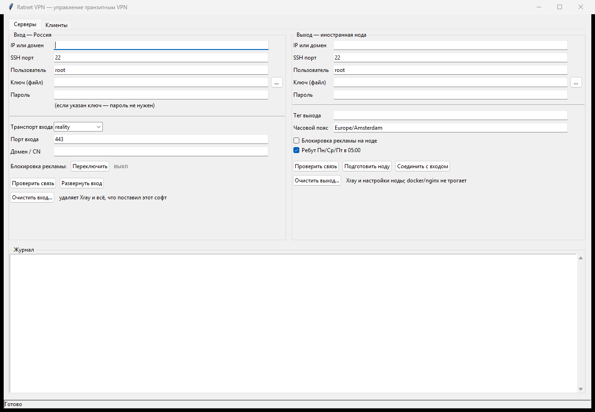

# Ratnet VPN

Десктопное приложение для управления транзитным VPN: **вход в России + зарубежные выходы**.
Работает на Windows и Linux, всё делает по SSH — на серверах ничего не нужно устанавливать
заранее, кроме доступа.



---

## Как это устроено

```
   клиент (телефон/ноутбук)
            │  VLESS + REALITY (или TLS / Hysteria2)
            ▼
   ┌──────────────────┐         ┌───────────────┐
   │  ВХОД — Россия   │────────▶│ выход: Хельсинки │
   │  Xray, :443      │         ├───────────────┤
   │  балансировщик   │────────▶│ выход: Амстердам │
   │  leastPing       │         ├───────────────┤
   └──────────────────┘         │ выход: Франкфурт │
            │                   ├───────────────┤
            │                   │ выход: Швеция    │
            ▼                   └───────────────┘
     рунет — напрямую
```

- Клиент всегда подключается **только к российскому входу**, поэтому при смене
  выходных нод профили у людей не меняются.
- Вход решает, куда отправить трафик: российские сайты — напрямую, остальное —
  через один из зарубежных выходов (выбирается автоматически по пингу).
- Всё, что делает приложение, выполняется по SSH теми же скриптами, что лежат
  в `ratnet/scripts/`. Приложение — это интерфейс, журнал и передача параметров.

---

## Что умеет

### Вкладка «Серверы»

| Слева — вход (Россия) | Справа — выход (иностранная нода) |
|---|---|
| IP, SSH-порт, пользователь, ключ или пароль | IP, SSH-порт, пользователь, ключ или пароль |
| Транспорт входа: `reality` / `tls` / `hysteria2` | Тег выхода, часовой пояс |
| Порт входа, домен-маскировка | Галочка «Блокировка рекламы на ноде» |
| Блокировка рекламы: кнопка + индикатор `вкл`/`выкл` | Галочка «Ребут Пн/Ср/Пт в 05:00» |
| «Проверить связь», «Развернуть вход» | «Проверить связь», «Подготовить ноду», «Соединить с входом» |
| «Очистить вход…» — вернуть сервер в исходное состояние | «Очистить выход…» |

Внизу — журнал. **Строки появляются сразу по мере выполнения**, а не после
завершения операции: видно, на каком шаге скрипт и где он завис.

### Вкладка «Клиенты»

- Таблица: клиент, израсходовано, лимит, статус.
- «Создать клиента» — имя и лимит в ГБ (0 — без лимита), сразу выдаётся готовая ссылка.
- «Удалить», «Сбросить лимит», «Ссылка», «Копировать ссылку».
- «Блокировать» / «Разблокировать» — доступ отключается и возвращается
  с **тем же UUID**, профиль на устройстве менять не нужно.
- Заблокированные клиенты остаются в таблице со статусом «заблокирован».

---

## Установка

### Вариант 1. Готовый exe (Windows)

Скачайте `RatnetVPN.exe` из раздела **Releases**, положите в любую папку и запустите.
Python и установка не нужны. Рядом можно положить папку `scripts` — тогда программа
возьмёт скрипты из неё (удобно править без пересборки), иначе использует встроенные.

### Вариант 2. Из исходников

Нужен **Python 3.10+**. На Windows при установке отметьте «Add python.exe to PATH».

```bash
python -m pip install -r requirements.txt
```

Единственная зависимость — `paramiko`. Tkinter входит в стандартный Python на Windows;
на Linux может понадобиться пакет:

```bash
sudo apt install python3-tk
```

Запуск:

- Windows: `run.bat`
- Linux/macOS: `./run.sh`
- или `python -m ratnet.gui`

---

## Как пользоваться

### 1. Подключение к серверам

В левой панели — российский вход, в правой — иностранная нода.
Укажите IP, пользователя (`root`) и либо путь к приватному ключу, либо пароль.
Кнопка «Проверить связь» покажет имя сервера и версию системы.

Пароли и ключи **не сохраняются на диск** — живут только в памяти процесса.

### 2. Развернуть вход

1. Выберите транспорт: `reality` (рекомендуется), `tls` или `hysteria2`.
2. При необходимости укажите порт (по умолчанию 443) и домен-маскировку.
3. Блокировка рекламы — по умолчанию **выключена**. Кнопка «Переключить» включает
   и выключает правило на уже настроенном входе; индикатор рядом показывает
   `вкл` / `выкл`, в журнале появляется «Включено» / «Выключено».
4. «Развернуть вход» — установит Xray, создаст конфиг, службу, учёт трафика,
   расписание ребутов. Существующий конфиг сохраняется в бэкап.

После развёртывания в журнале будут параметры входа и ссылка первого профиля.

### 3. Подготовить выход

1. Укажите IP и доступ к иностранной ноде.
2. Тег (например, `proxy-nl`), часовой пояс, при желании — блокировку рекламы
   на ноде и плановый ребут.
3. «Подготовить ноду» — установит Xray-выход и покажет **токен соединения**.
4. «Соединить с входом» — добавит выход в балансировщик входа и проверит его
   живым подключением.

### 4. Клиенты

- «Обновить» — список, расход, лимиты.
- «Создать клиента» — имя и лимит; ссылка появится внизу, кнопка «Копировать ссылку»
  положит её в буфер (не пропадает после закрытия программы).
- «Блокировать» / «Разблокировать» — выключить/вернуть доступ, UUID сохраняется.

### 5. Очистка сервера

Кнопки «Очистить вход…» и «Очистить выход…» возвращают сервер в состояние
«до Ratnet VPN»:

1. Показывается **список того, что будет удалено** (ничего не меняя).
2. Нужно подтвердить словом **Yes**.
3. Перед удалением создаётся бэкап `/root/ratnet-cleanup-<дата>.tar.gz`.

Удаляется: Xray, его конфиги и geo-файлы, службы `xray`, `vpn-quota.*`,
`vpn-traffic-log`, `singbox-h2`, наши скрипты, учёт трафика, квоты, расписание
ребутов, `nodes.txt`, строки cron.

**Не трогается:** docker и контейнеры AmneziaWG, nginx, node_exporter, resume-web,
системные пакеты, пользователи `xray`/`singbox`, правило `22/tcp`.

Откат: `tar -xzf /root/ratnet-cleanup-<дата>.tar.gz -C / && systemctl daemon-reload`,
затем `systemctl enable --now xray`.

---

## Буфер обмена

- В полях: **Ctrl+V**, **Ctrl+C**, **Ctrl+X**, **Ctrl+A**, работает **Shift+Insert**.
- Правая кнопка мыши в поле: «Вырезать / Копировать / Вставить / Выделить всё».
- В журнале: правая кнопка → «Копировать», «Копировать строку», «Копировать всё»;
  двойной клик выделяет слово (удобно копировать IP), тройной — строку.
- Скопированное кладётся в буфер Windows напрямую, поэтому не пропадает
  после закрытия приложения.

---

## Командная строка

То же самое без интерфейса — удобно для проверки и автоматизации.

```bash
# статус клиентов
python -m ratnet.cli --host 1.2.3.4 --key ~/.ssh/id_vpn status

# клиенты
python -m ratnet.cli --host 1.2.3.4 --key ~/.ssh/id_vpn create ivan --gb 10
python -m ratnet.cli --host 1.2.3.4 --key ~/.ssh/id_vpn link ivan
python -m ratnet.cli --host 1.2.3.4 --key ~/.ssh/id_vpn block ivan
python -m ratnet.cli --host 1.2.3.4 --key ~/.ssh/id_vpn unblock ivan
python -m ratnet.cli --host 1.2.3.4 --key ~/.ssh/id_vpn delete ivan

# реклама
python -m ratnet.cli --host 1.2.3.4 --key ~/.ssh/id_vpn adblock on

# установка/соединение
python -m ratnet.cli --host 1.2.3.4 --key ~/.ssh/id_vpn deploy --transport reality --entry-port 443
python -m ratnet.cli --host 1.2.3.4 --password 'pw' prepare --tz Europe/Amsterdam --tag proxy-nl
python -m ratnet.cli --host 1.2.3.4 --key ~/.ssh/id_vpn join <JOIN_TOKEN>

# очистка сервера (сначала предпросмотр)
python -m ratnet.cli --host 1.2.3.4 --key ~/.ssh/id_vpn cleanup --role entry --dry
python -m ratnet.cli --host 1.2.3.4 --key ~/.ssh/id_vpn cleanup --role entry --confirm Yes
```

В exe то же самое:

```bat
RatnetVPN.exe --host 1.2.3.4 --key %USERPROFILE%\.ssh\id_vpn status
```

---

## Сборка exe

```powershell
python -m pip install -r requirements.txt pyinstaller
powershell -ExecutionPolicy Bypass -File build.ps1
```

Результат: `dist\RatnetVPN.exe` и папка `RatnetVPN-portable` с exe, скриптами
и краткой инструкцией.

Проверка сборки:

```bat
RatnetVPN.exe --selftest
```

Отчёт пишется в `%TEMP%\ratnet-selftest.txt` (в том числе проверка SSH, если заданы
`RATNET_TEST_HOST` и `RATNET_TEST_KEY`). При падении — `%TEMP%\ratnet-crash.log`.

---

## Требования и безопасность

- Исходящий SSH-доступ к серверам с машины, где запущено приложение.
- Приложение подключается от `root` — оно меняет конфиги служб.
- Хост-ключи принимаются автоматически (как `StrictHostKeyChecking=no`).
- Токен соединения содержит ключи доступа к ноде — не пересылайте его.
- Пароли и ключи не сохраняются.

## Ограничения

- При транспорте **hysteria2** пофамильная статистика и лимиты на входе не работают:
  все клиенты приходят во вход одним транзитным пользователем. Маршрутизация
  и блокировка рекламы работают.
- Скорость per-user Xray не ограничивает — только объём (лимиты в ГБ).
- Зарубежные ноды перезагружаются по расписанию (Пн/Ср/Пт 05:00 по местному),
  вход — раз в 48 часов в 05:00 МСК.

---

## Структура проекта

```
RatnetVPN/
├── run.bat, run.sh          запуск из исходников
├── build.ps1                сборка портативного exe
├── launcher.py              точка входа (GUI / CLI / --selftest)
├── version_info.txt         свойства exe
├── requirements.txt
├── ratnet/
│   ├── ssh.py               SSH-подключение (paramiko), потоковый вывод
│   ├── actions.py           операции: статус, клиенты, установка, очистка
│   ├── gui.py               интерфейс (Tkinter)
│   ├── cli.py               командная строка
│   ├── paths.py             поиск скриптов (рядом с exe или внутри)
│   └── scripts/
│       ├── 01-ru-entry.sh      развернуть вход
│       ├── 02-foreign-node.sh  подготовить выход
│       ├── 03-join-node.sh     подключить выход к входу
│       ├── 04-client-block.sh  блокировка/разблокировка клиента
│       └── 05-cleanup.sh       возврат сервера в исходное состояние
└── docs/                    иконка, скриншот, инструкция для Windows
```

---

## Релизы

| Версия | Что внутри |
|---|---|
| `v1.0-huyalfa` | первый публичный релиз: портативный `RatnetVPN.exe` для Windows |

---

## Лицензия

Проект приватный, распространяется по решению владельца репозитория.
